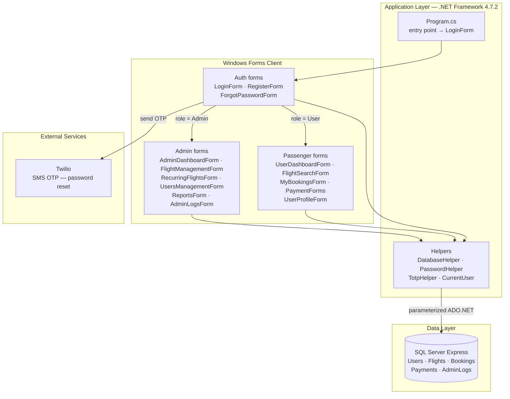
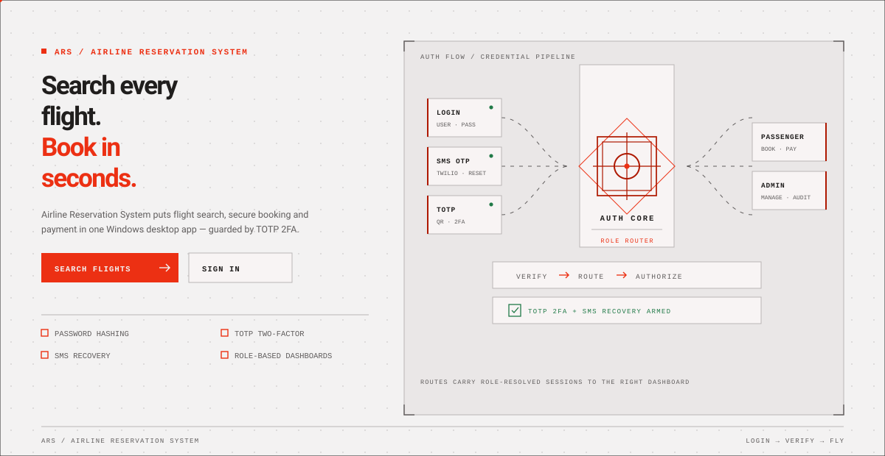

<div align="center">

# ✈️ Airline Reservation System

### ✨ Complete desktop airline booking system with 2FA, SMS recovery & full admin suite

<p align="center">
  <a href="https://github.com/FahadBinNasir/AirlineReservationSystemC-/stargazers">
    
  </a>

  <a href="https://github.com/FahadBinNasir/AirlineReservationSystemC-/network/members">
    
  </a>

  <a href="https://github.com/FahadBinNasir/AirlineReservationSystemC-/issues">
    
  </a>

  <a href="https://github.com/FahadBinNasir/AirlineReservationSystemC-/blob/main/LICENSE">
    
  </a>
</p>

<p align="center">
  
</p>


</div>

---

# 📌 Overview

> A full-featured Windows desktop application for airline ticket reservations — passengers search flights, book tickets and pay, while admins manage flights, users, reports and audit logs.

This project is designed to help users:
- ✅ Book and manage airline tickets through a real-world workflow
- ⚡ Move fast with role-based dashboards (passenger vs admin)
- 🎨 Use a clean, familiar Windows desktop UI
- 🚀 Rely on secure auth: hashing, TOTP 2FA & SMS recovery

---

# ✨ Features

## 🔥 Core Features

- 🔐 Authentication & authorization (passenger / admin roles)
- 🛡 TOTP two-factor authentication with QR setup
- 📱 SMS password reset via Twilio
- 🔍 Flight search
- 🎫 Ticket booking & payment flow
- 📊 Admin dashboard with reports & audit logs
- 📋 "My Bookings" management
- 👥 User management
- ✈️ Recurring flight schedules
- 🖥 Fully native Windows desktop UI

---

# 🏗 Application Architecture



> ℹ️ `TotpHelper` (TOTP 2FA via Otp.NET + QRCoder) is implemented in the codebase and ready to be wired into the login flow.

---

# 🛠 Tech Stack

<div align="center">

| Category | Technologies |
|---|---|
| 🖥 Frontend | C#, Windows Forms |
| ⚙ Framework | .NET Framework 4.7.2 |
| 🗄 Database | SQL Server (Express) via ADO.NET |
| 🔑 Authentication | Password hashing, TOTP 2FA (Otp.NET + QRCoder), Twilio SMS |
| 📦 Key Packages | Newtonsoft.Json, System.IdentityModel.Tokens.Jwt |
| 🧰 IDE | Visual Studio (Windows) |

</div>

---

# 📸 Screenshots

> 🎬 Live animated schematics in the project's blueprint style — they play right here in the README.

<div align="center">

## 🔐 Login & Auth Flow



---

## 🏠 Passenger Dashboard



---

## 🛠 Admin Dashboard



</div>


---

# 🚀 Live Demo

> 🖥 This is a Windows desktop application — there is no hosted web demo. Follow the Installation steps below to run it locally.

---

# 📂 Project Structure

```
AirlineReservationSystemC-/
│
├── AirlineReservationSystemNew.sln
├── AirlineReservationSystemNew/
│   ├── Program.cs                # Entry point — starts at LoginForm
│   ├── DatabaseHelper.cs         # Centralized ADO.NET data access
│   ├── PasswordHelper.cs         # Password hashing
│   ├── TotpHelper.cs             # TOTP 2FA logic
│   ├── CurrentUser.cs            # Session state
│   ├── App.config                # Connection string + settings
│   │
│   ├── LoginForm / RegisterForm / ForgotPasswordForm
│   ├── UserDashboardForm / AdminDashboardForm
│   ├── FlightSearchForm / FlightManagementForm / RecurringFlightsForm
│   ├── MyBookingsForm / PaymentForms
│   └── UsersManagementForm / AdminLogsForm / ReportsForm / UserProfileForm
│
└── README.md
```

---

# ⚙ Installation

## 📥 Clone Repository

```bash
git clone https://github.com/FahadBinNasir/AirlineReservationSystemC-.git
```

---

## 📂 Navigate

```bash
cd AirlineReservationSystemC-
```

---

## 📦 Install Dependencies

Open `AirlineReservationSystemNew.sln` in **Visual Studio** (Windows) — NuGet packages restore automatically on build:

```
Otp.NET, QRCoder, Twilio, Newtonsoft.Json, System.IdentityModel.Tokens.Jwt, ...
```

---

## 🗄 Set Up the Database

1. Install **SQL Server Express**
2. Create a database named `AirlineReservationSystem`
3. Update the connection string in `AirlineReservationSystemNew/App.config`

---

## ▶ Start the App

Press **F5** in Visual Studio — the app starts at the login screen.

---

# 🔑 Environment Variables

This project uses `AirlineReservationSystemNew/App.config` instead of a `.env` file:

```xml
<!-- Database -->
<add name="AirlineReservationSystem"
     connectionString="Data Source=YOUR_SERVER\SQLEXPRESS;Initial Catalog=AirlineReservationSystem;Integrated Security=True;TrustServerCertificate=True;" />

<!-- Twilio (SMS password reset) -->
<add key="TwilioAccountSid" value="YOUR_SID" />
<add key="TwilioAuthToken" value="YOUR_TOKEN" />
<add key="TwilioFromNumber" value="YOUR_NUMBER" />
```

> ⚠️ The SMS password-reset flow needs valid Twilio credentials to work.

---

# 📖 Usage

## 🧑‍💻 Passenger Flow

Register → verify login → optionally enable 2FA → search flights → book → pay → manage bookings under "My Bookings".

## 🛠 Admin Flow

Log in with an admin account → manage flights and recurring schedules → manage users → review logs and reports.

---

# 📡 API Endpoints

> 🖥 N/A — this is a desktop application with no HTTP API. All data access goes through `DatabaseHelper` (parameterized ADO.NET) directly to SQL Server.

---

# 📊 Performance Optimizations

- ⚡ ADO.NET connection pooling (on by default)
- 🚫 Parameterized queries — no string-built SQL
- 📦 Dialog-based booking flow loads only the selected flight's data
- 🖼 Lightweight WinForms UI — no web stack overhead

---

# 🔒 Security

- 🔐 Hashed passwords (no plaintext storage)
- 🛡 TOTP two-factor authentication
- 📱 SMS-based password recovery
- 🚫 Parameterized SQL queries (injection-safe data access)
- 🔒 TLS 1.2 enforced for network calls
- 🔑 Secrets kept in App.config (never hardcoded)

---

# 🧪 Testing

> No automated test suite yet — manual testing via Visual Studio (Debug → Start Debugging).

---

# 🚀 Deployment

## 📦 Build Release EXE

```
Build → Configuration Manager → Release → Build Solution
```

The compiled `.exe` lands in `AirlineReservationSystemNew/bin/Release/` — ship it together with its `.config` file.

## 🚀 ClickOnce Publish

Right-click the project → **Publish** → follow the ClickOnce wizard for one-click installs and auto-updates.

---

# 🤝 Contributing

Contributions are welcome!

## Steps

1. Fork the repository
2. Create a feature branch

```bash
git checkout -b feature-name
```

3. Commit changes

```bash
git commit -m "Added feature"
```

4. Push changes

```bash
git push origin feature-name
```

5. Open Pull Request

---

# 🌟 Roadmap

- [ ] Bundle a SQL schema script for one-command DB setup
- [ ] Email notifications for bookings (in addition to SMS)
- [ ] Seat-map seat selection UI
- [ ] Export reports to PDF/CSV
- [ ] Migrate data access to Entity Framework
- [ ] Add automated UI tests

---

# 👨‍💻 Contributors

<a href="https://github.com/FahadBinNasir/AirlineReservationSystemC-/graphs/contributors">
  
</a>

---

# 📈 GitHub Analytics

<div align="center">


</div>

---

# 📜 License

This project is licensed under the **MIT License**.

---

# 💖 Support

If you like this project:

⭐ Star the repository  
🍴 Fork the project  
🛠 Contribute to the codebase  

---

<div align="center">

## 🌌 Built with passion and creativity


</div>
